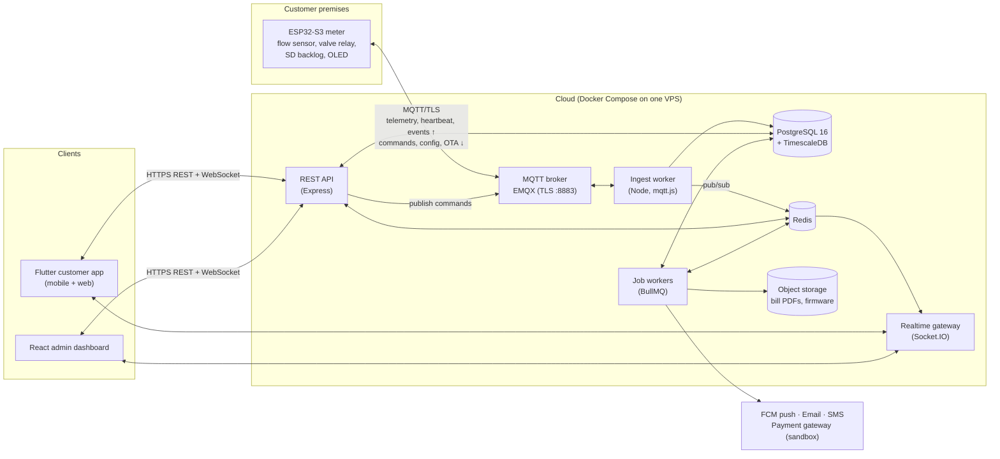
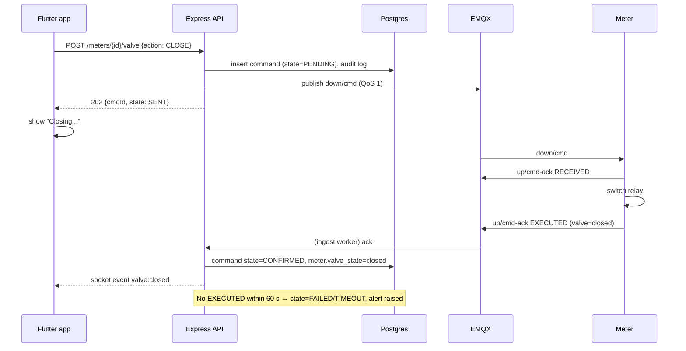
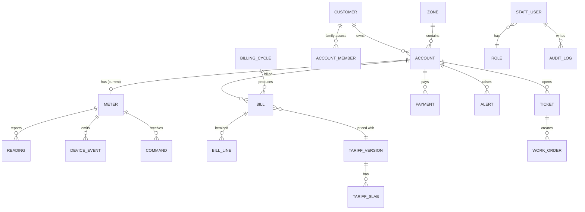

# Smart Water Meter: Implementation Plan and Architecture

Group 35. Companion to `Smart Water Meter Software Design.md`, which covers *what* to build. This document covers *how*: architecture, tech stack, the meter ↔ cloud contract, data model, APIs, and build order.

**Scope of this plan**

| Part | Technology | Users |
| --- | --- | --- |
| Backend (API, MQTT ingest, billing engine, jobs) | Node.js + Express + MQTT | — |
| Water board admin dashboard | React (web) | Admin, Billing Officer, Operations, Customer Service, Auditor |
| Customer app | Flutter (Android/iOS, plus Flutter Web as the customer web page) | Customers |
| Meter ↔ backend link | MQTT over TLS | ESP32-S3 meters |

---

## 1. Architecture overview



### Why this shape

- **The meter is only an MQTT client.** It never accepts inbound connections, so home routers and NAT are not a problem (design doc §2.1).
- **MQTT for the device, HTTPS for humans.** MQTT gives the ESP32 a persistent, low-overhead link with QoS 1 delivery, retained config, and a Last Will message that tells us instantly when a meter drops. Apps never talk MQTT; they use REST + WebSocket through the API, which enforces auth and ownership.
- **Ingest is separated from the API.** One Node process subscribes to the broker and writes readings; another serves HTTP. Both live in the same codebase (`backend/`) and share models, but run as separate containers so a burst of backlog uploads cannot slow down the apps.
- **The cloud owns the bill.** Meters send cumulative `totalLiters` + sequence number; billing reads closing snapshots (design doc §2.2–2.3).
- **TimescaleDB solves the data-volume problem.** 350 M rows/year at 10 000 meters (design doc §2) is handled with a hypertable, continuous aggregates for hourly/daily roll-ups, and a 90-day retention policy on raw data, all inside Postgres.

---

## 2. Tech stack

### 2.1 Backend (`backend/`)

| Concern | Choice | Notes |
| --- | --- | --- |
| Runtime / language | Node.js 22 LTS, TypeScript | Strict mode; shared types exported to the admin web. |
| HTTP framework | Express 5 | Routers per module, async error handling built in. |
| Validation | Zod | Request bodies, query params, and **MQTT payloads** use the same schemas. |
| ORM / DB access | Prisma (schema + migrations, CRUD) + raw SQL for Timescale features | Hypertable, continuous aggregates and retention are created in a raw SQL migration. |
| Database | PostgreSQL 16 + TimescaleDB extension | One database, no separate time-series store. |
| MQTT client | `mqtt` (mqtt.js v5) | Uses shared subscriptions (`$share/ingest/...`) so ingest can scale to N workers. |
| MQTT broker | **EMQX 5 (open source)** | Built-in per-device auth + ACL backed by Postgres or an HTTP hook to our API, TLS listener, web dashboard for debugging. *Alternative:* Mosquitto + dynamic-security plugin (lighter, but auth management is clumsier). |
| Cache, pub/sub, queues | Redis 7 + BullMQ | Live-flow fan-out, rate limits, OTP codes, scheduled jobs (billing cycle, reminders, offline sweep). |
| Realtime to clients | Socket.IO 4 | Rooms per meter (`meter:{id}`) and per staff dashboard. |
| Auth | JWT access token (15 min) + rotating refresh token (DB-stored, hashed) | Customers: phone/email OTP. Staff: email + password (argon2) + optional TOTP. RBAC middleware for staff roles. |
| PDF bills | `pdfkit` (or Puppeteer rendering an HTML template) | Generated on publish, stored in object storage, served via signed URL. |
| Notifications | Firebase Cloud Messaging (push), Nodemailer (SMTP), SMS provider adapter (Notify.lk / mock) | Behind a `Notifier` interface so SMS can stay mocked. |
| Payments | PayHere **sandbox** (Sri Lankan gateway) or an in-house mock page | Webhook → `payments` table. Real money is out of scope (design doc §8). |
| Object storage | MinIO (S3-compatible) in Docker | Bill PDFs, firmware binaries for OTA. |
| Logging / monitoring | Pino (JSON logs), `/health` + `/metrics` (prom-client) | Optional Grafana later. |
| Testing | Vitest + Supertest; Testcontainers for Postgres | Billing engine gets the heaviest unit tests. |
| API docs | OpenAPI 3 generated from Zod (`zod-to-openapi`), served with Swagger UI | Flutter models can be generated from it. |

### 2.2 Admin dashboard (`admin-web/`)

| Concern | Choice |
| --- | --- |
| Build / language | Vite + React 19 + TypeScript |
| Routing | React Router 7 |
| Server state | TanStack Query (caching, polling, optimistic updates) |
| UI kit | Tailwind CSS + shadcn/ui (Radix primitives) |
| Tables | TanStack Table (fleet table, bills, payments: server-side paging/filter) |
| Charts | Recharts |
| Map | React-Leaflet + OpenStreetMap tiles, marker clustering by zone |
| Forms | React Hook Form + Zod (reuses backend schemas from a shared package) |
| Realtime | `socket.io-client` (live meter status, new alerts) |
| Auth | Access token in memory, refresh token in httpOnly cookie; route guards by role |
| i18n | English first (staff), `react-i18next` ready |
| Testing | Vitest + React Testing Library; Playwright for key flows (billing run, valve approval) |

### 2.3 Customer app (`mobile_app/`)

| Concern | Choice |
| --- | --- |
| Framework | Flutter 3.x (Dart 3), targets Android, iOS, **and Web** (Web build = the customer web page in design doc §5) |
| State management | Riverpod 2 (with code generation) |
| Navigation | go_router (bottom-nav shell with 5 tabs: Home, Usage, Bills, Alerts, More) |
| HTTP | Dio + interceptor for token refresh |
| Models | freezed + json_serializable |
| Realtime | `socket_io_client` (live flow L/min, valve state, alerts) |
| Charts | fl_chart (usage graphs, tier progress, budget line) |
| Push | firebase_messaging + flutter_local_notifications |
| Secure storage | flutter_secure_storage (refresh token) |
| QR scan (add meter) | mobile_scanner |
| Meter Wi-Fi provisioning | **BLE provisioning** using Espressif's unified provisioning protocol (`esp_provisioning_ble`-style package) since the ESP32-S3 has BLE. Fallback: SoftAP mode, where the phone joins the meter hotspot and POSTs credentials to `192.168.4.1`. |
| Localization | Flutter `intl` + ARB files: English, Sinhala, Tamil |
| PDF viewing | `pdfx` or open signed URL in browser |
| Payments | WebView to the gateway sandbox/mock checkout, result confirmed by backend webhook |
| Theme | Dark-first design matching the NWSDB SelfCare reference (navy surfaces, blue primary, red for amounts due) |
| Testing | flutter_test widget tests, integration_test for sign-up → add meter → live flow |

### 2.4 Dev tooling and infra

- **Monorepo** with folders below; one `docker-compose.yml` brings up Postgres/Timescale, Redis, EMQX, MinIO, API, ingest worker, job worker.
- **Meter simulator** (`tools/meter-simulator`, Node): spawns N fake meters that speak the exact MQTT contract below. Lets the app and dashboard team work before hardware is ready, and gives load tests and demo data.
- **Deployment:** a single VPS (2 vCPU / 4 GB is enough for the demo), Caddy as reverse proxy with automatic HTTPS for `api.` and `admin.`, EMQX exposes 8883 (MQTT/TLS).
- **CI:** GitHub Actions: lint + typecheck + tests for backend and admin-web, `flutter analyze` + tests for the app, build Docker images on `main`.

---

## 3. Repository layout

```
smart-water-meter/
├── backend/
│   ├── src/
│   │   ├── api/            # Express app: routes, controllers, middleware (auth, rbac, audit)
│   │   ├── ingest/         # MQTT subscriber: telemetry, backlog, heartbeat, events, cmd acks
│   │   ├── jobs/           # BullMQ workers: billing, reminders, offline sweep, leak rules, notifications
│   │   ├── realtime/       # Socket.IO gateway (Redis adapter)
│   │   ├── modules/        # Domain logic per module: meters, readings, billing, tariffs, payments, ...
│   │   ├── mqtt/           # Topic builders, payload schemas, command publisher
│   │   ├── lib/            # db, redis, logger, notifier, storage, pdf
│   │   └── entrypoints/    # api.ts, ingest.ts, worker.ts  (one image, three commands)
│   ├── prisma/             # schema.prisma + migrations (incl. raw SQL for Timescale)
│   └── test/
├── admin-web/
│   └── src/ (pages/, features/, components/, api/, hooks/, lib/)
├── mobile_app/
│   └── lib/ (core/, features/{auth,home,usage,bills,alerts,more,provisioning}/, l10n/)
├── packages/
│   └── contracts/          # Shared Zod schemas + TS types (API DTOs, MQTT payloads)
├── tools/
│   └── meter-simulator/
├── infra/
│   ├── docker-compose.yml
│   ├── emqx/               # listener, TLS, auth/ACL config
│   └── Caddyfile
└── docs/
    ├── Smart Water Meter Software Design.md
    └── PLAN_AND_ARCHITECTURE.md
```

---

## 4. Meter ↔ backend contract (MQTT)

This is the most important interface in the system. The firmware team and the backend team both build against it, and the simulator implements it first.

### 4.1 Connection and identity

| Item | Value |
| --- | --- |
| Transport | MQTT 3.1.1 (or 5) over TLS, port 8883. ESP32 uses `esp-mqtt` with the broker's CA cert embedded. |
| Client ID | `meter-{meterId}` (for example `meter-SWM-000123`) |
| Username / password | `meterId` / per-device secret (generated at manufacture, stored **hashed** in `meters.device_secret_hash`). EMQX validates via HTTP auth hook → `POST /internal/mqtt/auth`. |
| ACL | A meter may only publish to `swm/v1/meters/{ownId}/up/#` and subscribe to `swm/v1/meters/{ownId}/down/#`. Enforced by the broker (`POST /internal/mqtt/acl` or EMQX built-in rules). |
| Keep-alive | 60 s |
| Last Will | topic `.../up/status`, payload `{"online":false}`, QoS 1, **retained** |
| On connect | publish `.../up/status` `{"online":true,"fw":"1.2.0","bootId":"..."}` retained, then subscribe to `down/#` |

Claim code (printed on the meter as QR) is different from the device secret. The claim code only links a meter to a customer account; it is never used to authenticate the device.

### 4.2 Topics

Prefix: `swm/v1/meters/{meterId}`

| Direction | Topic | QoS | Retained | Purpose |
| --- | --- | --- | --- | --- |
| ↑ device → cloud | `up/status` | 1 | yes | Online/offline (with LWT) |
| ↑ | `up/telemetry` | 1 | no | Periodic cumulative reading |
| ↑ | `up/live` | 0 | no | Fast flow-rate samples while someone is watching |
| ↑ | `up/backlog` | 1 | no | Batch of SD-buffered readings after an outage |
| ↑ | `up/heartbeat` | 0 | no | RSSI, uptime, free heap, supply voltage |
| ↑ | `up/event` | 1 | no | Valve changed, power loss, tamper suspicion, boot |
| ↑ | `up/cmd-ack` | 1 | no | Command lifecycle updates |
| ↓ cloud → device | `down/cmd` | 1 | no | Valve open/close, live mode on/off, reboot, sync time |
| ↓ | `down/config` | 1 | **yes** | Calibration factor, intervals, tariff slabs for OLED estimate |
| ↓ | `down/ota` | 1 | no | Firmware update offer |

Backend subscribes with shared subscriptions, for example `$share/ingest/swm/v1/meters/+/up/#`.

### 4.3 Payloads (JSON, kept small)

**Telemetry** (every 15 min, and immediately when the valve changes):
```json
{ "seq": 18342, "ts": 1763550000, "bootId": "a91f", "upMs": 5400123,
  "totalL": 123456.7, "flowLpm": 0.0, "valve": "open" }
```
- `seq`: monotonic counter persisted on SD, never resets. Backend stores with `UNIQUE(meter_id, seq)` and inserts `ON CONFLICT DO NOTHING`, so retries and duplicates are harmless.
- `ts`: Unix seconds from NTP, or `0` if the clock is not set yet. If `0`, the backend reconstructs time from `bootId` + `upMs` once a later message in the same boot carries a valid `ts` (design doc §3, "No real-time clock").
- `totalL`: cumulative litres. Usage for any period = difference of cumulative values, so lost messages lose nothing.

**Live** (every 2–5 s, only while live mode is on):
```json
{ "ts": 1763550002, "flowLpm": 6.4, "totalL": 123457.1 }
```
Live mode is turned on by a `down/cmd` with a TTL (for example 120 s) when a customer opens the Home screen, and is renewed while they watch. This keeps data usage low and gives the "big live number" in the app.

**Backlog** (after reconnect, chunks of ≤ 50 readings):
```json
{ "items": [ { "seq": 18300, "ts": 1763540000, "bootId": "a91e", "upMs": 120000, "totalL": 123300.2 } ] }
```

**Heartbeat** (every 5 min):
```json
{ "ts": 1763550000, "rssi": -67, "fw": "1.2.0", "heap": 182000, "vin": 4.9, "onBattery": false }
```

**Event:**
```json
{ "seq": 18343, "ts": 1763550100, "type": "POWER_LOSS" | "POWER_RESTORED" | "VALVE_CHANGED" | "BOOT" | "TAMPER_SUSPECTED", "data": {} }
```

**Command** (cloud → device):
```json
{ "cmdId": "c_01JD...", "type": "VALVE_CLOSE" | "VALVE_OPEN" | "LIVE_ON" | "LIVE_OFF" | "REBOOT" | "SYNC_CONFIG",
  "args": { "ttlSec": 120 }, "expiresAt": 1763550300 }
```

**Command ack** (device → cloud), sent once per stage:
```json
{ "cmdId": "c_01JD...", "state": "RECEIVED" | "EXECUTED" | "FAILED", "valve": "closed", "err": null }
```
The device ignores expired commands and remembers recent `cmdId`s so a redelivered QoS 1 message does not toggle the valve twice.

**Config** (retained, re-sent whenever it changes):
```json
{ "ver": 7, "calFactor": 7.5, "telemetrySec": 900, "heartbeatSec": 300,
  "tariff": { "slabs": [ { "upTo": 10, "rate": 10 }, { "upTo": null, "rate": 15 } ], "service": 400 } }
```

**OTA offer:**
```json
{ "version": "1.3.0", "url": "https://.../fw/1.3.0.bin?sig=...", "sha256": "…", "size": 1048576 }
```

### 4.4 Valve command lifecycle



Board-initiated shut-off adds two steps before publishing: state `AWAITING_APPROVAL` → a **second** officer approves with a reason → then sent (design doc §3, "Valve safety").

---

## 5. Data model

PostgreSQL. Money stored as integer cents (`BIGINT`), volumes as litres (`NUMERIC(14,3)`); m³ is computed for display.



| Table | Key columns |
| --- | --- |
| `customers` | id, name, phone, email, preferred_lang, fcm_tokens[] |
| `accounts` | id, account_no, customer_id, zone_id, address, lat/lng, status (ACTIVE/SUSPENDED/CLOSED), budget_m3 |
| `account_members` | account_id, customer_id, role (OWNER/MEMBER/VIEWER) |
| `zones` | id, name, polygon (GeoJSON) |
| `meters` | id (`SWM-000123`), account_id, claim_code_hash, device_secret_hash, fw_version, cal_factor, valve_state, online, last_seen_at, rssi, config_ver, installed_at |
| `readings` *(hypertable)* | meter_id, seq, ts, ts_corrected (bool), total_l, flow_lpm, valve, received_at. **UNIQUE(meter_id, seq)** |
| `readings_hourly`, `readings_daily` *(continuous aggregates)* | meter_id, bucket, first_total_l, last_total_l, usage_l, max_flow |
| `device_events` | meter_id, seq, ts, type, data JSONB |
| `heartbeats` *(hypertable, 30-day retention)* | meter_id, ts, rssi, heap, vin, on_battery |
| `commands` | id, meter_id, type, args, initiated_by (customer/staff), reason, approved_by, state, timestamps per state |
| `tariff_versions` | id, name, effective_from, status (DRAFT/APPROVED/SCHEDULED/ACTIVE/RETIRED), service_charge_cents, approved_by |
| `tariff_slabs` | tariff_version_id, from_m3, to_m3 (null = ∞), rate_cents_per_m3 |
| `billing_cycles` | id, period (YYYY-MM), state (SNAPSHOT/VALIDATING/EXCEPTIONS/GENERATED/APPROVED/PUBLISHED), stats |
| `meter_snapshots` | billing_cycle_id, meter_id, closing_total_l, source (ACTUAL/ESTIMATED/HELD) |
| `bills` | id, account_id, cycle_id, opening_l, closing_l, usage_m3, usage_cents, service_cents, arrears_cents, adjustments_cents, total_cents, due_date, status (DRAFT/PUBLISHED/PAID/OVERDUE), data_basis (LIVE/SD_SYNCED/ESTIMATED), pdf_key, locked_at |
| `bill_lines` | bill_id, kind (TIER/SERVICE/ARREARS/PENALTY/ADJUSTMENT), description, qty_m3, rate_cents, amount_cents, tariff_version_id |
| `adjustments` | bill_id, type (CREDIT_NOTE/DEBIT), amount_cents, reason, created_by, approved_by |
| `payments` | id, account_id, bill_id?, amount_cents, method, gateway_ref, status, paid_at |
| `alerts` | id, account_id, meter_id, type (LEAK/HIGH_USAGE/BUDGET_80/OFFLINE/TAMPER/BILL_DUE/NOTICE), severity, status, opened_at, resolved_at |
| `tickets`, `work_orders` | complaint/job tracking, assignee (staff), status, linked alert |
| `notices` | title, body (per language), zone_ids[], starts_at, ends_at |
| `staff_users`, `roles`, `permissions` | RBAC |
| `audit_logs` | actor, action, entity, entity_id, before JSONB, after JSONB, ip, at |
| `refresh_tokens`, `otp_codes` | auth |

**Timescale setup (raw SQL migration):** `create_hypertable('readings','ts')`, continuous aggregates for hourly and daily usage, `add_retention_policy('readings', INTERVAL '90 days')`, aggregates kept forever, compression on chunks older than 7 days.

---

## 6. Backend modules and key logic

### 6.1 Ingest worker
1. Validate payload with Zod; drop and log malformed messages.
2. `readings`: insert with `ON CONFLICT (meter_id, seq) DO NOTHING`.
3. Update `meters.last_seen_at`, `online`, `valve_state`, `rssi` (batched every few seconds to avoid write storms).
4. Publish to Redis channel `meter:{id}` → Socket.IO pushes to app/dashboard.
5. Run cheap inline checks: negative delta (counter reset/tamper), flow while valve closed (fault), valve-closed but `flowLpm > 0`.

### 6.2 Scheduled jobs (BullMQ)
| Job | Schedule | Does |
| --- | --- | --- |
| Offline sweep | every 1 min | `last_seen_at` older than 3 × heartbeat → mark offline, raise OFFLINE alert |
| Leak rules | every 15 min | continuous flow > N hours, or night-window flow (00:00–04:00) above threshold → LEAK alert |
| Budget check | hourly | month usage ≥ 80 % / 100 % of budget → alert |
| Command timeout | every 30 s | commands stuck in SENT/RECEIVED > 60 s → FAILED |
| Billing snapshot | last day 23:59 | create `billing_cycle`, store closing reading per meter |
| Due-date reminders | daily 09:00 | 3 days before due, overdue flag after due, penalty if configured |
| Notification dispatch | queue | push / email / SMS fan-out with retries |

### 6.3 Billing engine (pure, unit-tested function)

```
priceBill(openingL, closingL, periodStart, periodEnd, tariffVersions[], readingsAtBoundaries)
  -> split the period at each tariff effective_from inside it
  -> usage per segment = cumulative(segmentEnd) - cumulative(segmentStart)
  -> apply slabs to each segment (slab limits pro-rated by segment length)
  -> add service charge, arrears, adjustments
  -> return BillLines[]
```
Test case from the design doc: 12 m³ with slabs 0–10 @ Rs.10, >10 @ Rs.15, service Rs.400 → 100 + 30 + 400 = **Rs.530**.

Cycle states follow design doc §6: Snapshot → Validation → Exceptions queue → Generate → Review/Approve → Publish (lock bill, generate PDF, notify). After publish, bills are immutable; changes go through `adjustments`.

### 6.4 Security
- TLS everywhere (HTTPS, MQTTS). Device secrets and claim codes stored hashed.
- Customer can access a meter only via `account_members` → checked in one middleware.
- Staff RBAC by permission strings (`billing.approve`, `valve.close.request`, `valve.close.approve`, ...). Requester ≠ approver enforced in code.
- Every staff write goes through an audit middleware. Staff reads of a customer's detailed usage are also logged (privacy, design doc §8).
- Rate limiting on OTP and login (Redis), helmet, CORS allow-list.

---

## 7. REST API (v1, summary)

Base: `https://api.<domain>/api/v1`. Full spec generated as OpenAPI.

**Customer**

| Method + path | Purpose |
| --- | --- |
| `POST /auth/otp/request`, `POST /auth/otp/verify` | Sign-up / login |
| `POST /auth/refresh`, `POST /auth/logout` | Tokens |
| `GET /me`, `PATCH /me` | Profile, language, FCM token |
| `GET /accounts` | My accounts/meters (multi-account switcher) |
| `POST /meters/claim` | `{meterId, claimCode}` → link to account |
| `GET /meters/:id/summary` | Home screen: status, this month m³, estimate, tier progress, valve, top alert |
| `GET /meters/:id/usage?range=day\|week\|month&from&to` | Graph data from aggregates |
| `POST /meters/:id/live` | Start/renew live mode |
| `POST /meters/:id/valve` | `{action: OPEN\|CLOSE}` → 202 + cmdId |
| `GET /accounts/:id/bills`, `GET /bills/:id`, `GET /bills/:id/pdf` | Bills, breakdown, PDF |
| `GET /bills/estimate?accountId=` | Current month estimate |
| `POST /tariffs/calculate` | Bill calculator |
| `POST /payments/checkout`, `POST /payments/webhook` | Payment (sandbox) |
| `GET /alerts`, `PATCH /alerts/:id` | Alerts tab |
| `GET/PUT /accounts/:id/settings` | Budget, alert thresholds, Away Mode, members |
| `GET/POST /tickets` | Complaints |
| `GET /notices` | Board notices |

**Staff (admin dashboard)**, prefix `/admin`, RBAC-guarded

| Area | Endpoints |
| --- | --- |
| Dashboard | `GET /admin/stats/overview`, `GET /admin/stats/consumption` |
| Map | `GET /admin/map/meters?zone=` |
| Customers & accounts | CRUD `/admin/customers`, `/admin/accounts`, `POST /admin/accounts/:id/assign-meter` |
| Meters | `GET /admin/meters` (fleet table), `GET /admin/meters/:id`, `POST /admin/meters` (register + generate secret/claim code), `PATCH /admin/meters/:id` (calibration), `POST /admin/meters/:id/replace` |
| OTA | `POST /admin/firmware` (upload), `POST /admin/ota/rollouts` (staged %), `GET /admin/ota/rollouts/:id` |
| Analytics | `GET /admin/analytics/zones`, `/top-consumers`, `/anomalies`, `/night-flow` |
| Tariffs | CRUD `/admin/tariffs`, `POST /admin/tariffs/:id/preview`, `/approve`, `/schedule` |
| Billing | `POST /admin/billing-cycles`, `GET /admin/billing-cycles/:id/exceptions`, `PATCH /admin/billing-cycles/:id/exceptions/:meterId`, `/generate`, `/approve`, `/publish` |
| Payments & arrears | `GET /admin/payments`, `GET /admin/arrears`, `POST /admin/reminders`, adjustments/credit notes |
| Valve | `POST /admin/valve-requests`, `POST /admin/valve-requests/:id/approve` \| `/reject`, `GET /admin/commands` |
| Tickets | `/admin/tickets`, `/admin/work-orders` |
| Notices | CRUD `/admin/notices` (by zone, multilingual) |
| Reports | `GET /admin/reports/:type?format=pdf\|csv` |
| Users & audit | `/admin/users`, `/admin/roles`, `GET /admin/audit-logs` |

**Internal** (broker → API, not public): `POST /internal/mqtt/auth`, `POST /internal/mqtt/acl`.

**WebSocket events:** `meter:live` (flow), `meter:status`, `meter:valve`, `alert:new`, `bill:published`, `admin:meter-status`, `admin:alert`.

---

## 8. Admin dashboard (React) pages

Left sidebar, items filtered by role:

| Page | Main components | Roles |
| --- | --- | --- |
| Dashboard | KPI cards (active meters, online %, consumption today/month, open alerts, issued/collected/overdue), trend charts | All |
| Map | Leaflet map, zone filter, red = offline/leak, click → meter drawer | Admin, Ops, CS |
| Customers & Accounts | Search table, account detail (meter, bills, payments, tickets, alerts tabs), new connection form | Admin, CS, Billing |
| Meters | Fleet table (last seen, fw, RSSI, cal factor, tamper flags), detail with live chart, recalibrate, OTA, replace | Admin, Ops |
| Analytics | Zone usage, night-flow list, top consumers, anomalies | Admin, Ops, Auditor |
| Tariffs | Version list, slab editor, preview calculator with sample bills, approve/schedule | Admin, Billing |
| Billing | Cycle wizard: snapshot → exceptions queue → generate → review totals & sample bills → approve → publish | Billing (approve needs a different officer) |
| Payments & Arrears | Payments list, reconciliation, overdue list, send reminders, disconnection workflow | Billing |
| Valve Commands | Request form (reason), approvals inbox, history with lifecycle states | Ops request, Admin approve |
| Tickets & Work Orders | Kanban/list, assign technician, link alert | CS, Ops |
| Notices | Compose (EN/SI/TA), target zones, schedule | Admin, CS |
| Reports | Revenue, consumption, collection rate; PDF/CSV export | Admin, Billing, Auditor |
| Users & Audit Log | Staff CRUD, role assignment, searchable audit log | Admin, Auditor (read) |

---

## 9. Customer app (Flutter) screens

Bottom navigation: **Home · Usage · Bills · Alerts · More**. Account switcher in the app bar (as in the NWSDB reference screenshots).

| Flow / tab | Screens |
| --- | --- |
| Onboarding | Language pick → phone/email → OTP → profile |
| Add meter | Scan QR (or type meter ID + claim code) → **Wi-Fi provisioning wizard** (BLE, SoftAP fallback) → wait for first telemetry → "Meter connected" |
| Home | Header card (account, Online/Offline), live flow L/min, this month m³ + estimated bill, tier progress bar, big valve switch with confirm dialog and "Closing..." state, top alert strip, quick actions (Pay, Bills, Complaint, Calculator) |
| Usage | Day/week/month toggle, bar/line chart, this vs last month, budget line with 80 % warning |
| Bills | Current estimate card, past bills list (like the reference "Bill Details" cards), breakdown screen ("Explain my bill": per-tier lines, service, arrears), PDF, **Pay Now** |
| Pay | Amount due, method, amount, proceed → gateway WebView → result |
| Alerts | Filter chips (leak, high usage, device, billing, notices), detail with action (e.g. close valve on leak) |
| More | Profile, accounts & meters, family members, budget & alert settings, Away Mode, language, complaints/tickets, FAQ, bill calculator, logout |

The same Flutter codebase builds for web (`flutter build web`) to serve as the customer web page; the layout switches to a left `NavigationRail` above ~900 px width, and web-only extras (CSV export, print bill) are added behind `kIsWeb`.

---

## 10. Key flows end to end

**Live flow on Home:** app opens Home → `POST /meters/:id/live` → API publishes `LIVE_ON {ttlSec:120}` → meter sends `up/live` every 3 s → ingest → Redis → Socket.IO room → app updates the big number. App renews every 60 s while visible; meter stops automatically when TTL expires.

**Outage and recovery:** Wi-Fi drops → broker publishes LWT offline → app shows grey "Offline" → meter keeps writing readings to SD with `seq` → Wi-Fi back → meter publishes `status online`, then `up/backlog` chunks → ingest inserts (duplicates ignored), fixes timestamps → aggregates refresh → bills for that period get `data_basis = SD_SYNCED`.

**Leak alert:** leak rule job sees flow > 0 for every 15-min bucket over 3 h (or night-window flow) → `alerts` row → FCM push "Possible leak" with a "Close valve" action → Away Mode also notifies family members.

**Monthly billing:** snapshot job → officer opens the cycle in the dashboard → resolves exceptions → generate → another officer approves → publish → PDFs generated, push/email sent → customer sees the bill in the Bills tab.

---

## 11. Build plan (milestones)

Assumes a team of 3–5 working in parallel after Milestone 0. Weeks are indicative.

| # | Milestone | Deliverables | Weeks |
| --- | --- | --- | --- |
| 0 | **Foundations & contract** | Monorepo, docker-compose (Postgres+Timescale, Redis, EMQX, MinIO), Prisma schema v1, `packages/contracts` with MQTT + API schemas, **meter simulator** speaking the contract, CI | 1 |
| 1 | **Device pipeline** | EMQX auth/ACL hook, ingest worker (telemetry, backlog, heartbeat, status, events), idempotent inserts, Timescale aggregates, offline sweep, Socket.IO live channel. Firmware: replace hardcoded Wi-Fi, TLS MQTT, seq + SD backlog | 2–3 |
| 2 | **Customer app core** | OTP auth, account switcher, claim meter, Home (live flow, month usage, status), Usage charts. Wi-Fi provisioning wizard against real ESP32 | 3–5 |
| 3 | **Valve control** | Command lifecycle, acks, timeouts, app valve switch with "Closing...", admin valve requests with two-person approval, audit log | 5 |
| 4 | **Admin dashboard core** | Staff auth + RBAC, Dashboard KPIs, Meters fleet + detail, Customers/Accounts, Map | 4–6 |
| 5 | **Tariffs & billing** | Tariff versions + preview, billing engine with tests (incl. mid-month split), billing cycle wizard, bill PDFs, Bills tab + breakdown in app | 6–8 |
| 6 | **Alerts & notifications** | Leak/budget/offline/tamper rules, FCM push, email, Alerts tab, Away Mode, notices by zone | 8–9 |
| 7 | **Payments, tickets, reports** | Sandbox/mock payment + webhook, arrears & reminders, tickets/work orders, reports export | 9–10 |
| 8 | **OTA, i18n, polish** | OTA upload + staged rollout, Sinhala/Tamil strings, Flutter Web build, deployment to VPS with HTTPS/MQTTS, demo script | 11–12 |

**Demo script** (design doc §8): run meter → live flow in app → close valve from phone → trigger leak (simulator or open tap at night window) → run billing cycle in admin → open the published bill in the app and pay (sandbox).

**Minimum viable demo** if time runs short: Milestones 0–3 + the billing part of 5 + a basic dashboard (4). Tickets, OTA, and reports are the first things to cut.

---

## 12. Risks and decisions to confirm

| Topic | Decision / risk | Proposed answer |
| --- | --- | --- |
| Broker choice | EMQX vs Mosquitto | EMQX: HTTP auth/ACL hook and dashboard save time. Revisit only if VPS memory is tight. |
| Customer web | Separate React app vs Flutter Web | Flutter Web (one codebase), as the design doc suggests one codebase for customers. |
| Wi-Fi provisioning | BLE vs SoftAP | BLE on ESP32-S3 (better UX, phone stays on its own Wi-Fi). Implement SoftAP as fallback if BLE stack size is an issue. |
| Sensor limits | YF-S201 misses flows < ~1 L/min | State in app ("±10 %, slow drips not detected") and in report. |
| Clock | No RTC | NTP + seq/bootId time repair on server; DS3231 as optional upgrade. |
| SMS | Cost | Mock adapter by default; push + email are free. |
| Payment | Real gateway approval | PayHere sandbox or mock; show Pay&Go integration as future work. |
| Scale | 10 000 meters | One ingest worker handles this easily at 15-min intervals (~11 msg/s). Shared subscriptions allow more workers if needed. |
| Privacy | Usage reveals presence | Per-account access control, staff detailed-usage views audit-logged, raw data deleted after 90 days. |
